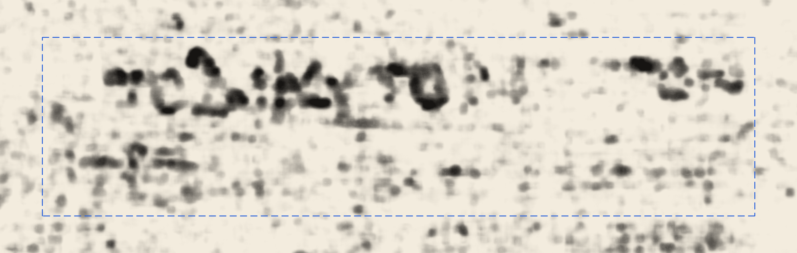
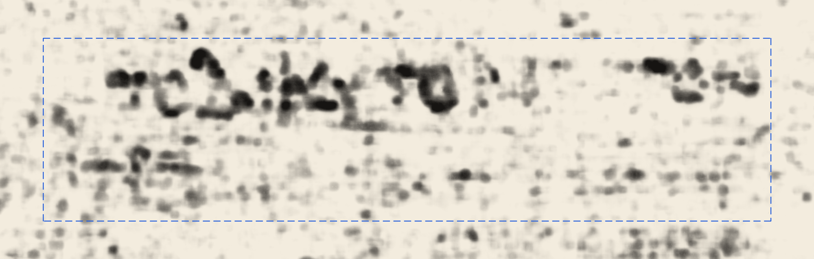
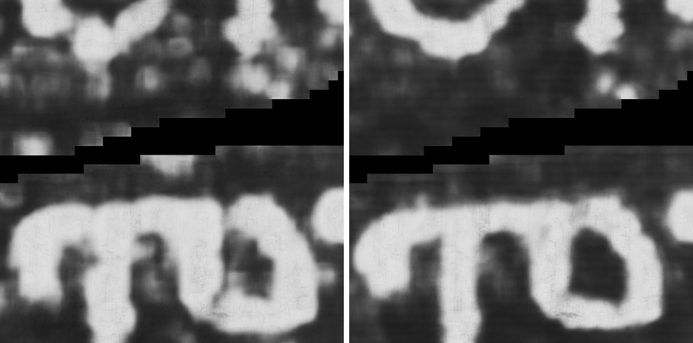

# Retraining the PHerc. 0306B First Letters winner's members on a 12 GB GPU

The model that won PHerc. 0306B First Letters (SirProdigle / Liam Warner and Nicola Bodill, [`pherc0306b-first-letters`](https://github.com/SirProdigle/pherc0306b-first-letters)) comes with a guide that says retraining "needs one GPU with 24 GB or more" and marks its training mode "not run end to end". I ran that training end to end on one RTX 4070 with 12 GB and 16 GB of RAM, with the winner's own Docker image, code, weights and data, and compared every stage with their shipped files. The retrained members match the shipped maps more closely than the winner's own seeds match each other. I then fine-tuned the model on new labels from Scroll 1 in a pre-registered demo, at about 25 minutes a training run, and ran the same inference on a Mac.



*The winners' claim image*



*Mine, retrained end to end on one 12 GB RTX 4070*

Contents: [Results](#results) · [Reproduce it](#reproduce-it) · [The retrain](#the-retrain) · [How close it gets](#how-close-it-gets) · [Fine-tuning on new labels](#fine-tuning-on-new-labels) · [Apple Silicon](#apple-silicon) · [Licence and credits](#licence-and-credits)

The full write-up, with every table, deviation and source file, is in [`docs/details.md`](docs/details.md). [`CLAIMS.md`](CLAIMS.md) points each claim to its evidence.

## Results

| | result |
|---|---|
| retrain on 12 GB | stages 1–8 of the winner's training for the A-hn members, on an RTX 4070 with 16 GB of RAM: 8.4 GPU-hours, whole-card peak 9,706 MiB |
| how close | retrained members r 0.9925–0.9934 against the shipped maps, closer than the winner's own seeds agree (0.932–0.942); fused claim map r 0.9992; the redrawn claim image differs by more than 8/255 on 0.042% of pixels |
| exact inference | every map the claim uses, rerun with the shipped recipe: r ≥ 0.9999997 against the shipped maps, and r ≥ 0.999994 for the depth-shuffle control maps. Separately, an optional fused A-hn forward on the same 4070, gated and not float16-exact (members r 0.999997–0.999998 on the B0 native window, no-text control passed), runs a member 1.69× faster |
| fine-tune demo | with the new labels, +0.046 / +0.050 AUC over zero-shot on pair 1 and +0.136 / +0.141 on pair 2, ahead of the same training without them in every comparison; 24–27 min per training run |
| Apple Silicon | all five maps and the winner's fusion on an M5 Pro: TRACE r 0.999999, members r ≥ 0.99999993, fused product r 0.99999977 against the 4070, float16-exact. Separately, a gated Core ML rewrite of A-hn on the same M5 Pro, not float16-exact (members r ≥ 0.999994, fused product r 0.9999993, no-text control passed), runs the four members in 1.20× the time of the 4070's unmodified path, against 4.7× before |

I also opened a pull request to the winner's repository with the 12 GB configs and a REPRODUCE note: [SirProdigle/pherc0306b-first-letters#8](https://github.com/SirProdigle/pherc0306b-first-letters/pull/8).

## Reproduce it

You need an NVIDIA GPU with 12 GB, Docker with GPU support, `git`, `uv`, `tmux` and `python3`. I tested on Windows 11 with WSL2 and Docker Desktop, and the pagefile has to be able to grow. Pick a data directory with about 45 GB free, then run:

```bash
export VESUVIUS_DATA=/path/to/vesuvius-data
bash pc/download_winner.sh                      # about 23 GB: the winner's repo, model and dataset
bash pc/zstd_load.sh "$VESUVIUS_DATA/winner/hf-data/docker/fl-claim-a7_final.tar.zst"
STAGES=masks,teach_readers,teach_v8,labels,exclusion,packs,anchors_shipped,train,members,fuse bash pc/train_e2e/e2e_chain.sh
bash pc/train_e2e/stage9.sh                     # redraws the claim image (CPU)
```

Run the training chain detached, for example in `tmux`. It resumes from finished outputs, and each stage compares its output with the shipped file. The exact-inference chain, the optional checks, the settings and a test run from the published file set are in [`docs/details.md`](docs/details.md#how-to-run-it).

## The retrain

The retrain covers the trained half of the claim map, the A-hn members. TRACE v3B, the other half, is a third-party model that the winner's `train` mode doesn't train, so it runs with its shipped weights. The whole chain took about 8.4 GPU-hours plus 0.4 CPU-hours, and the card peaked at 9,706 MiB while training, desktop included.

The winner's trainer already supports 12 GB. It defaults to per-block activation checkpointing with a 9 GB budget, but their shipped A-hn configs opt out of it. On the 4070 a training step without checkpointing runs out of memory at micro-batch 4, so my recipe sets their own block mode directly with a 10.5 GB budget. What I add is the measurement that this fits a 12 GB card and reproduces the whole chain, a check that BatchNorm statistics under checkpointing equal the plain run exactly, and the Windows/WSL memory findings with a host guard. Without that guard a 16 GB PC can crash the WSL VM during training, and mine did once when the pagefile couldn't grow. The scripts run every stage in the winner's image and compare it with their shipped artifact.

Details: [what "stages 1–8" means](docs/details.md#what-stages-18-means), [cost and what makes it fit](docs/details.md#the-retrain-scope-cost-and-what-makes-it-fit), [Windows/WSL memory](docs/details.md#windowswsl-memory).

## How close it gets

Each member was retrained with its own seed, as shipped, from training data I regenerated from the shipped inputs. My three members correlate with the shipped ones at r 0.9926, 0.9934 and 0.9925, while the winner's own seeds agree with each other at 0.932–0.942. They fall short of a retrain from the shipped packs, which reaches 0.99958, because the regenerated training data differs slightly and GPU training isn't bit-exact. Most of the fused-map agreement comes from TRACE, which both sides share.

Two checks hold up. On the winner's depth-shuffled render my retrained models lose the claim, as theirs do, and regenerating TRACE or rerunning a member map gives bit-identical maps. I redrew the claim image with their `final` mode and pixel-diffed it against theirs, which is the figure above.

Details: [verification](docs/details.md#verification), [inference on 12 GB](docs/details.md#inference-on-12-gb-every-map-the-claim-uses-to-float16-precision), [the optional fused A-hn forward](docs/details.md#an-optional-fused-a-hn-forward-on-the-4070).

## Fine-tuning on new labels

The question was whether the winner's A-hn model, retrained with this 12 GB recipe, can learn from a new scroll's labels and improve on papyrus it never saw. I wrote the protocol before the first GPU run and tested it on two train/test pairs of Scroll 1 segments. Each pair compares the shipped model zero-shot, the model trained further with the new labels, and the same training without them, with two seeds for each trained arm. The new labels raised test AUC by +0.046 / +0.050 on pair 1 and +0.136 / +0.141 on pair 2 over zero-shot, and beat the no-label controls in every comparison, with every paired 95% interval excluding 0.



*Scroll 1, pair 1, held-out test segment w09, trained on w03. Left: the shipped model zero-shot (a). Right: the model fine-tuned with w03's labels (b2). The full figures for both pairs are in [the details](docs/details.md#images-and-data).*

Each crop is the 768 × 768 px window of the test segment with the most labelled ink, among windows at least 30% inside its supervision mask. Black areas in the map panels lie outside the supervision mask the scores are computed in.

It is a demonstration that the recipe adapts the model to new labels, not a result about Scroll 1. The labels are pseudo-labels from one model-in-the-loop process, so part of the gain may be agreement with that labeller rather than with the ink. The full limits, results, deviations and the commands to run it on your own segment are in [the demo section of the details](docs/details.md#demo-fine-tuning-on-new-labels-from-scroll-1).

The two crops above are published with the organisers' written consent (Paul, Vesuvius Challenge, 2026-11-20). Scroll 1's data terms forbid publishing ink-label images, or text revealed from them, without that consent, so no other Scroll 1 map, label or image is included. Scroll 1 data comes from the EduceLab-Scrolls dataset (Parsons et al., arXiv:2304.02084, 2023); the full citation is in [`CREDITS.md`](CREDITS.md).

## Apple Silicon

The winner's inference code also runs on an Apple M5 Pro through PyTorch's MPS backend, with a device shim and a small harness and no model, weight or method change. All five maps and the winner's own fusion match the 4070's CUDA maps to float16 precision on the B0 native window, about 5.85 cm² of the claim render. B0 is my name for a fixed test window around the claim box, defined in [`docs/b0-baseline-2026-11-15.md`](docs/b0-baseline-2026-11-15.md) with its code in `pc/b0/`. The Mac takes 1.71× as long on TRACE, and the whole chain runs at 1.21 cm²/GPU-h against the 4070's 5.36.

A-hn was most of that gap. Following villa PR #2634 (campbelltron1) and HerculeX's stem fold (Adam Betka), which run 3-D convolutions through 2-D kernels on Apple silicon, I rewrote A-hn's network with 2-D operations only (same weights, BatchNorm folded), converted it to Core ML and ran it on the M5 Pro's Neural Engine and GPU at once. On that path the four members take 4,342 s against 3,623 s on the 4070's unmodified path, and the chain runs at 4.40 cm²/GPU-h on the M5 Pro. It changes the float16 arithmetic, so it is a separate, gated path: members r ≥ 0.999994 with 90–92 % of pixels on the same 8-bit level, fused product r 0.9999993, and the no-text control behaves as on the 4070. The appendix also has a short note on speeding up HerculeX on the same Mac. See [`apple-silicon.md`](apple-silicon.md).

## Licence and credits

My code and documentation are MIT ([`LICENSE`](LICENSE)). Maps, numbers and images derived from the winner's or the Vesuvius Challenge data are CC BY-NC 4.0 ([`LICENSE-DATA`](LICENSE-DATA)), with credit to the winner and the Vesuvius Challenge.

No weights are shipped. Retrained checkpoints derive from CC BY-NC 4.0 data and the CC BY-NC-SA 4.0 TRACE v3B weights, so the scripts download the winner's own image, weights and data instead. The winner's code is MIT and runs inside their image unmodified. My wrappers set the recipe, meaning the inputs, ROI, grid origin and `clip_to_roi`, and the 12 GB config. Full credits are in [`CREDITS.md`](CREDITS.md).
